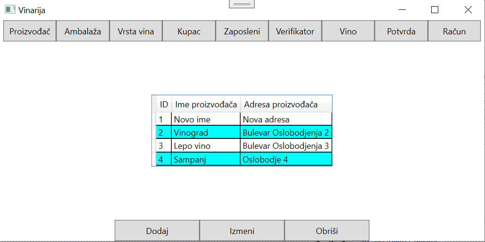
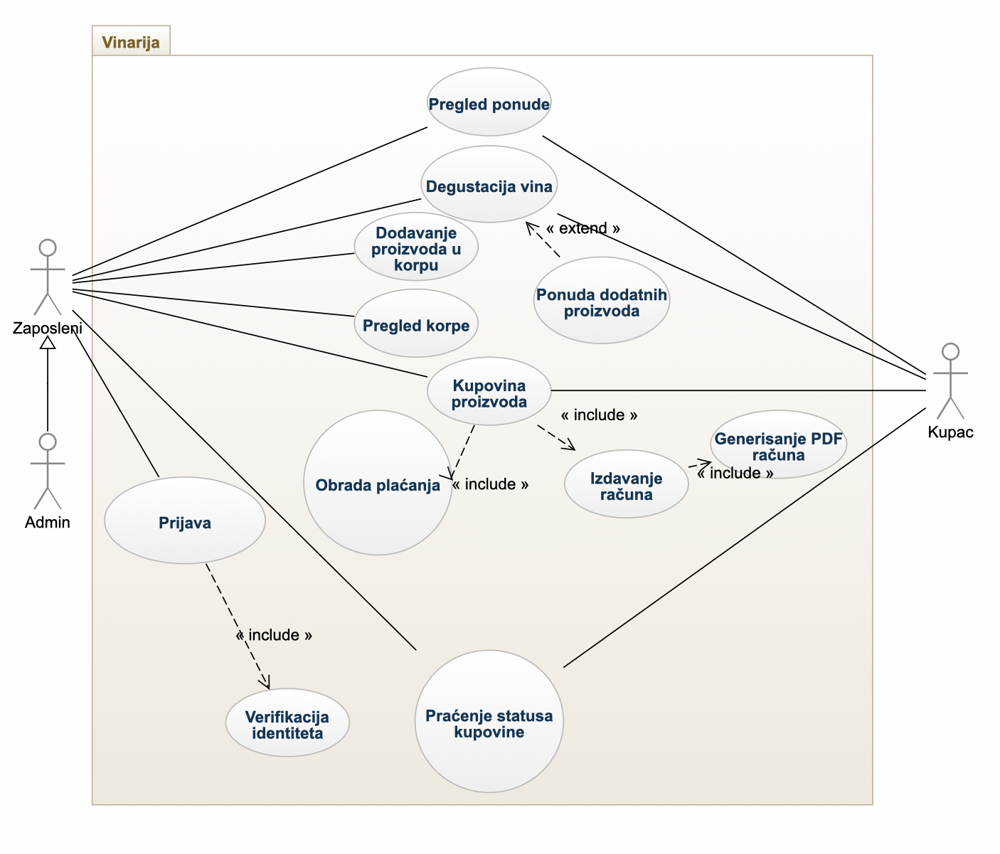
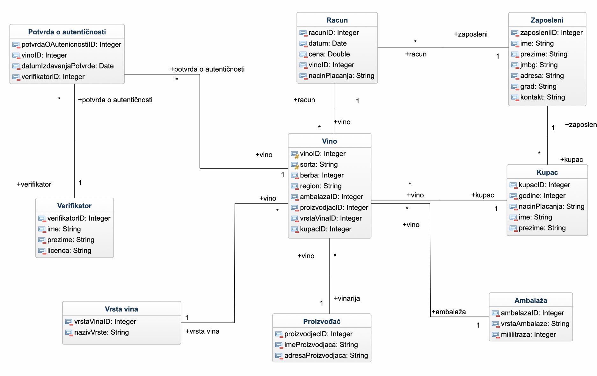

# Winery Management System — WPF & SQL Server

A desktop application for a winery information system, built with C# and WPF on .NET 8. Employees can manage wines, producers, packaging, wine types, customers, employees, verifiers, invoices and wine authenticity certificates, all stored in a SQL Server database.

## Features

- A button for each of the 9 database tables loads its records into the main data grid
- Add and edit records through a separate form for each table, and delete the selected record from the main window
- Drop-down lists for related data (for example, choosing the producer, packaging and wine type when adding a wine)
- Confirmation before deleting, and a clear message when a record can't be deleted because other data depends on it

## Tech stack

- C#, .NET 8, WPF (XAML)
- ADO.NET (`Microsoft.Data.SqlClient`): `SqlConnection`, `SqlCommand`, `SqlDataReader`
- SQL Server Express
- Visual Studio

## How it works

- **Database access:** the `Konekcija` class creates the database connection in one place, and every screen uses it.
- **Parameterized queries:** all inserts, updates and deletes use `SqlParameter`, so user input is never concatenated into SQL. This protects the app from SQL injection.
- **Shared methods in the main window:** `UcitajPodatke` loads a table into the grid, `PopuniFormu` fills the edit form with the selected record, and `ObrisiZapis` deletes the selected record after confirmation.

## Design

The system was modeled in UML before implementation.

### Use case diagram

### Class diagram

## Database

The `vinarija1` database has 9 tables: `Vino`, `Proizvodjac`, `Ambalaza`, `VrstaVina`, `Kupac`, `Zaposleni`, `Verifikator`, `Racun` and `PotvrdaOAutenticnosti`. Primary keys identify each record, and foreign keys link wines to their producer, packaging and type, and link invoices and certificates to wines.

## Running locally

1. Install SQL Server Express and create a database named `vinarija1` with the tables above.
2. Open `Vinarija1.sln` in Visual Studio 2022 (Windows).
3. If your SQL Server instance has a different name, change `DataSource` in `Vinarija1/Konekcija.cs`. The app uses Windows authentication, so no password is needed.
4. Run the project.

## Related project

The same winery database is also exposed as a REST API in MuleSoft: [vinarija-mulesoft-api](https://github.com/NikolinaAzasevac/vinarija-mulesoft-api).

## Author

Nikolina Azaševac — Information Systems Engineering, Faculty of Technical Sciences, University of Novi Sad
